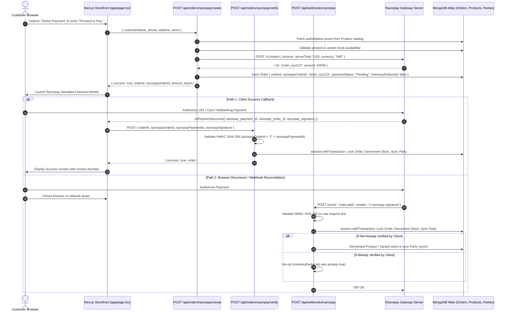

# Customer Razorpay Payment Gateway Integration

*   **Author:** kishoresharmaks
*   **Status:** Approved
*   **Date:** 2026-11-15

--------------------------------------------------------------------------------

## Overview

This design outlines the migration of the customer storefront payment flow from an unverified manual UPI QR code and UTR submission process to an automated integration with Razorpay Standard Checkout (`checkout.js`). The new flow handles orders across UPI, credit/debit cards, net banking, and wallets, while retaining Cash on Delivery (COD) as an independent choice. It incorporates server-side cryptographic signature validation, an asynchronous webhook reconciliation worker for dropped browser sessions, and atomic multi-document database transactions that guarantee inventory is only deducted upon verified payment capture.

## The Problem

The current checkout mechanism in `app/page.tsx` relies on customer-side manual intervention:
1. **High Friction and Cart Abandonment**: Customers are prompted to switch apps, scan a dynamic QR code or copy a merchant VPA, complete payment in their banking app, locate a 12-digit bank reference (UTR) number, and manually paste it into the storefront before placing an order.
2. **Fraud Risk and Manual Reconciliation**: Orders are recorded in a `Pending` state based solely on whatever text the customer types into the transaction ID field. Store personnel must manually log into their banking portal or UPI app to cross-reference each UTR against bank credits before processing shipments.
3. **Premature Stock Decrementing**: In `app/api/orders/route.ts`, inventory is decremented when the checkout payload is received. Unpaid abandoned orders hold phantom inventory, reducing available stock for paying customers.
4. **Lack of Drop-Off Recovery**: If a customer completes payment at their bank but their network drops or they close the browser tab before the callback completes, the transaction is orphaned with no automated fulfillment mechanism.

The proposed solution replaces the manual UPI interface with the Razorpay Standard Checkout modal. A server-side endpoint generates a Razorpay gateway order entity, the frontend opens the checkout popup, and the server validates the HMAC SHA-256 signature upon return. A secondary webhook listener intercepts `order.paid` events directly from Razorpay to guarantee order fulfillment even if the browser disconnects. Inventory is decremented atomically inside a MongoDB transaction only after cryptographic proof of payment is confirmed.

## Goals

*   Eliminate manual UTR entry by integrating Razorpay Standard Checkout in the customer checkout modal (`app/page.tsx`).
*   Defer inventory deduction until payment is cryptographically verified on the server, eliminating phantom inventory holds on abandoned checkouts.
*   Support automated recovery for dropped client sessions via authenticated asynchronous Razorpay webhooks (`order.paid` and `payment.captured`).
*   Enforce idempotent database operations using MongoDB multi-document transactions to prevent duplicate order generation or double inventory deduction if the client callback and webhook fire simultaneously.
*   Detect and flag simultaneous-checkout stock depletion scenarios (`inventoryConflict: true`) in the database and display a prominent warning badge in the admin dashboard without canceling captured payments.
*   Retain Cash on Delivery (COD) with existing store settings toggles (`models/Settings.ts`).

## Non-Goals

*   Automated programmatic refunds on stock-out: The merchant evaluates inventory conflicts in the dashboard and issues restocks or refunds manually.
*   In-store POS counter hardware or API integration: In-store billing continues using local counter cash and static UPI QR.
*   Recurring subscriptions or auto-debit billing schedules for consumer retail products.
*   Custom white-label payment gateway UI: Razorpay Standard Checkout modal satisfies all brand and UX requirements without custom card-form PCI compliance overhead.
*   External asynchronous message queues (e.g. BullMQ, Redis, SQS): Webhook processing executes inline within the Route Handler under an aligned SLA.

## Open Questions

*   None: All major architectural questions (inventory deduction timing, webhook recovery, settings schema compatibility, conflict resolution, and TTL index removal) were resolved during ideation and review.

## Critical User Journeys (CUJs)

### CUJ 1: Successful Online Purchase via Razorpay
*   **Given**: A customer has products in their cart and opens the checkout drawer on the storefront.
*   **When**: The customer enters shipping details, selects "Online Payment (Razorpay)", and clicks "Proceed to Pay".
*   **Then**: The storefront requests a Razorpay order from `POST /api/orders/razorpay/create`. The server recalculates pricing from the catalog and creates an order record with `paymentStatus: 'Pending'`. The Razorpay modal opens. The customer completes payment via UPI/Card. Razorpay invokes the client callback, which sends verification data to `POST /api/orders/razorpay/verify`. The server verifies the HMAC signature, updates `paymentStatus: 'Paid'`, decrements product/variant stock atomically, and displays the order confirmation screen with the generated invoice ID.

### CUJ 2: Recovery of Dropped Browser Session via Webhook
*   **Given**: A customer completes payment in their bank app via the Razorpay modal.
*   **When**: The customer's mobile device loses connectivity or the customer closes the browser tab before the client callback executes.
*   **Then**: Razorpay sends an asynchronous `order.paid` webhook to `POST /api/webhooks/razorpay`. The webhook validates the `X-Razorpay-Signature` against `RAZORPAY_WEBHOOK_SECRET` using raw request text. It locates the pending order, atomically updates `paymentStatus: 'Paid'`, decrements product/variant stock, and sets `inventoryDeducted: true`. When the customer later checks order status via phone number, the order displays as Paid.

### CUJ 3: Simultaneous Checkout on Last Unit (Inventory Conflict)
*   **Given**: Product A has 1 unit remaining in stock. Customer 1 and Customer 2 both open the checkout modal simultaneously.
*   **When**: Both customers authorize payment on Razorpay. Customer 1's payment verifies first and decrements the remaining unit to 0. Customer 2's payment verifies 2 seconds later.
*   **Then**: Customer 2's order is verified and updated to `paymentStatus: 'Paid'`. The atomic inventory check detects 0 remaining stock, sets `inventoryConflict: true`, and records conflict notes without allowing negative stock. The transaction is not refunded automatically; a prominent `⚠️ Stock Conflict` badge is surfaced in the admin dashboard for the store manager to fulfill from backorder or issue a refund via the Razorpay portal.

### CUJ 4: Cash on Delivery Checkout (Regression Protection)
*   **Given**: A customer selects "Cash on Delivery" in the checkout drawer.
*   **When**: The customer clicks "Place Cash on Delivery Order".
*   **Then**: The order is submitted to `POST /api/orders`. The order is created with `paymentMethod: 'COD'`, `paymentStatus: 'Pending'`, and inventory is decremented immediately using the unified inventory service, matching the existing operational workflow.

--------------------------------------------------------------------------------

## Technical Plan (Architecture)

### Component Architecture & Module Responsibilities

The online payment system consists of four primary components:
1. **Client Checkout Layer (`app/page.tsx`)**: Renders payment options, dynamically binds the Razorpay Checkout SDK, initializes payment modals, and routes payment responses.
2. **Order Creation Service (`POST /api/orders/razorpay/create`)**: Queries authoritative catalog prices from `models/Product.ts`, contacts Razorpay to generate a gateway order entity, creates a persistent `Pending` order in MongoDB, and returns checkout options to the client.
3. **Cryptographic Verification Worker (`POST /api/orders/razorpay/verify`)**: Validates the SHA-256 HMAC signature returned by the client, executes atomic database state transitions, and triggers product and variant stock deductions via `lib/inventory.ts`.
4. **Asynchronous Webhook Listener (`POST /api/webhooks/razorpay`)**: Consumes raw HTTP requests from Razorpay's webhook infrastructure, validates the webhook HMAC signature, and executes idempotent order fulfillment when client-side callbacks are interrupted.

### System Data Flow



### Data Model & Schema Modifications

#### 1. Schema Extensions in `models/Order.ts`
```typescript
{
  paymentMethod: {
    type: String,
    enum: ['COD', 'UPI', 'CASH', 'RAZORPAY'],
    required: true,
  },
  paymentStatus: {
    type: String,
    enum: ['Pending', 'Paid', 'Failed'],
    default: 'Pending',
  },
  razorpayOrderId: { type: String, sparse: true, index: true },
  razorpayPaymentId: { type: String, sparse: true, index: true },
  razorpaySignature: { type: String },
  inventoryDeducted: { type: Boolean, default: false, index: true },
  inventoryConflict: { type: Boolean, default: false },
  conflictNotes: { type: String, default: '' },
}
```
*(Note: Database-level TTL index has been eliminated to ensure paid customer orders and invoices are preserved permanently).*

#### 2. Schema Extensions in `models/Settings.ts`
```typescript
{
  key: { type: String, required: true, unique: true, default: 'global' },
  enableOnlinePayment: { type: Boolean, default: true },
  enableUPI: { type: Boolean, default: true },
  enableCOD: { type: Boolean, default: true },
}
```

### Concurrency and Idempotency Invariants

1. **Multi-Document Transaction Boundary**: Double-deductions and partial inventory decrements are eliminated by wrapping order state updates and stock deductions within `await session.withTransaction(...)` in `lib/inventory.ts`.
2. **Guarded Decrement Filters**:
   - Standalone product: `Product.findOneAndUpdate({ _id: item.productId, quantity: { $gte: item.quantity } }, { $inc: { quantity: -item.quantity } }, { session })`.
   - Variant product: `Product.findOneAndUpdate({ _id: item.productId, 'variants.name': item.variantName, 'variants.quantity': { $gte: item.quantity } }, { $inc: { 'variants.$.quantity': -item.quantity, quantity: -item.quantity } }, { session })`.
   - If stock is insufficient (`matchedCount === 0`), do not decrement below zero; flag `inventoryConflict = true` and append conflict notes within the same transaction.
3. **Sequential Order ID Safety**: Replaces `Order.countDocuments()` with a timestamp-sequence pattern (`ORD-${Date.now().toString().slice(-6)}-${Math.floor(1000 + Math.random() * 9000)}`) to eliminate duplicate key collisions.
4. **Next.js 14 Raw Body Webhook Verification**: Consumes `await request.text()` before invoking `crypto.createHmac('sha256', secret).update(body).digest('hex')`.

--------------------------------------------------------------------------------

## Alternatives Considered

### Alternative A: Manual Direct UPI + UTR Entry (Status Quo)
*   **Pros**: Zero transaction processing fees.
*   **Cons**: Unacceptable checkout drop-off rates; fraud risk from unverified reference numbers; labor-intensive manual bank statement reconciliation.
*   **Reason for Rejection**: Rejected due to high cart abandonment and manual reconciliation vulnerabilities from forged customer-supplied reference numbers.

### Alternative B: Pre-Payment Inventory Locking with Timeouts
*   **Pros**: Guarantees stock availability for the shopper while completing payment.
*   **Cons**: Strands inventory on abandoned payment screens; requires a distributed scheduled worker or cron job to release expired holds.
*   **Reason for Rejection**: Rejected due to stranded inventory during drop-offs and operational overhead of distributed lock expiry workers.

### Alternative C: Storing Order Payloads Exclusively in Razorpay Notes
*   **Pros**: Avoids creating uncommitted pending records in MongoDB prior to payment.
*   **Cons**: Razorpay limits the `notes` metadata object to 15 key-value pairs and 256 characters per value, which truncates complex multi-item orders and long delivery addresses.
*   **Reason for Rejection**: Rejected due to strict character limits in Razorpay metadata that truncate multi-item shopping carts and extended delivery addresses.

### Alternative D: Automated Programmatic Refunds on Stock Depletion
*   **Pros**: Zero merchant touchpoint needed when simultaneous checkouts exhaust stock.
*   **Cons**: Bank refunds take 5 to 7 business days to credit back to the customer's account, causing customer disputes; deprives the merchant of fulfilling via incoming replenishment stock.
*   **Reason for Rejection**: Rejected due to bank settlement delays that frustrate buyers and deprive merchants of fulfilling from incoming reserve stock.

--------------------------------------------------------------------------------

## Non-Functional Requirements

### Security & Secrets Management
*   `RAZORPAY_KEY_SECRET` and `RAZORPAY_WEBHOOK_SECRET` remain strictly server-side environment variables and must never be exposed via `NEXT_PUBLIC_*` prefixes.
*   All webhooks validate the `x-razorpay-signature` header using HMAC SHA-256 over raw request text before executing database mutations.
*   All client-side verification requests validate the cryptographic signature over `razorpay_order_id + "|" + razorpay_payment_id`.
*   All prices used in order creation are fetched and calculated directly on the server from the product catalog.

### Performance & Latency
*   Order creation endpoint executes in < 500ms.
*   Webhook listener executes inline and responds with `200 OK` in < 2000ms (comfortably within Razorpay's 5000ms retry timeout).
*   Razorpay SDK script (`checkout.js`) is loaded non-blockingly using Next.js `<Script strategy="lazyOnload">`.

### Rollout & Backward Compatibility
*   The `models/Settings.ts` configuration preserves `enableUPI` as a backward-compatible fallback while introducing `enableOnlinePayment`.
*   Cash on Delivery (COD) remains fully backward-compatible and operational independently of Razorpay gateway availability.

--------------------------------------------------------------------------------

## Risks & Limits

1. **Razorpay Gateway Downtime**: If Razorpay's API is unreachable, `POST /api/orders/razorpay/create` returns HTTP 503 and the storefront displays an ambient notice suggesting Cash on Delivery.
2. **Webhook Replay Attacks**: Handled via idempotency: `fulfillOrderAtomically` checks if the order is already marked `inventoryDeducted: true` and immediately returns the existing record as a no-op.
3. **Simultaneous Checkout Stock Exhaustion**: Mitigated by setting `inventoryConflict: true` and alerting the merchant in the admin order list.

--------------------------------------------------------------------------------

## Detailed Implementation Plan (Phased Execution)

### Phase 1: Environment Configuration & Schema Migration
*   **`.env.example`**: Add `RAZORPAY_KEY_ID`, `NEXT_PUBLIC_RAZORPAY_KEY_ID`, `RAZORPAY_KEY_SECRET`, `RAZORPAY_WEBHOOK_SECRET`.
*   **`models/Order.ts`**:
    *   Add `'RAZORPAY'` to `paymentMethod` enum.
    *   Add `razorpayOrderId`, `razorpayPaymentId`, `razorpaySignature` (string, sparse indexes).
    *   Add `inventoryDeducted` (boolean, default: false, indexed).
    *   Add `inventoryConflict` (boolean, default: false) and `conflictNotes` (string).
*   **`models/Settings.ts`**:
    *   Add `enableOnlinePayment: { type: Boolean, default: true }`.
*   **Verification Gate 1**: Run `npm run build` to verify type compatibility across existing models.

### Phase 2: Gateway Utilities & Shared Fulfillment Service
*   **`lib/razorpay.ts` (Create)**:
    *   Export `createRazorpayOrder({ amount, currency, receipt, notes })`.
    *   Export `verifyRazorpayPaymentSignature({ razorpayOrderId, razorpayPaymentId, razorpaySignature })`.
    *   Export `verifyRazorpayWebhookSignature({ rawBody, signature })`.
*   **`lib/inventory.ts` (Create)**:
    *   Export `fulfillOrderAtomically({ orderId, razorpayOrderId, razorpayPaymentId, razorpaySignature })`.
    *   Wraps fulfillment inside MongoDB `session.withTransaction`.
    *   Performs guarded conditional decrements against `Product.quantity` and `Product.variants.$.quantity`.
    *   If depleted, sets `inventoryConflict: true` and records notes without decrementing stock below zero.
    *   Syncs customer info into `Party` model.
    *   Returns `FulfillOrderResult { success, order, alreadyFulfilled, conflict }`.
*   **Verification Gate 2**: Compile and verify unit exports in `lib/`.

### Phase 3: Route Handlers & Webhook Endpoints
*   **`app/api/orders/razorpay/create/route.ts` (Create)**:
    *   Validates customer details and items.
    *   Checks `settings.enableOnlinePayment ?? settings.enableUPI`.
    *   Recalculates subtotals, GST, and grand total authoritatively from `Product.findById`.
    *   Calls `createRazorpayOrder`.
    *   Creates `Order` in MongoDB with `paymentStatus: 'Pending'` and safe sequential `orderId`.
    *   Emits PostHog `razorpay_order_created` telemetry.
    *   Returns `{ success: true, orderId, razorpayOrderId, amount, currency: 'INR', keyId }`.
*   **`app/api/orders/razorpay/verify/route.ts` (Create)**:
    *   Accepts `{ orderId, razorpayOrderId, razorpayPaymentId, razorpaySignature }`.
    *   Validates HMAC signature.
    *   Calls `fulfillOrderAtomically`.
    *   Emits PostHog `razorpay_payment_verified` telemetry.
    *   Returns `{ success: true, message: 'Payment verified', data: order }`.
*   **`app/api/webhooks/razorpay/route.ts` (Create)**:
    *   Reads `await request.text()`.
    *   Validates `x-razorpay-signature` against `RAZORPAY_WEBHOOK_SECRET`.
    *   Handles `order.paid` and `payment.captured`.
    *   Calls `fulfillOrderAtomically` by `razorpayOrderId`.
    *   Returns `200 OK` in < 2000ms.
*   **`app/api/orders/route.ts` (Modify)**:
    *   Refactor COD flow to delegate stock decrements and party sync to `lib/inventory.ts`.
    *   Adopt collision-resistant sequence logic.
    *   Remove obsolete manual UPI UTR validation logic.
*   **`app/api/settings/route.ts` (Modify)**:
    *   Return `enableOnlinePayment` alongside `enableUPI` for backwards compatibility.
*   **Verification Gate 3**: Route handlers compile cleanly and pass API validation.

### Phase 4: Storefront & Admin UI Integration
*   **`app/page.tsx` (Modify)**:
    *   Add TypeScript `interface Window { Razorpay: any; }`.
    *   Inject Next.js `<Script src="https://checkout.razorpay.com/v1/checkout.js" strategy="lazyOnload" />`.
    *   Replace manual UPI VPA copy and UTR input with modern "Pay Online (UPI, Cards, NetBanking)" selector.
    *   Integrate Razorpay popup launcher in `handlePlaceOrder`:
        *   Calls `/api/orders/razorpay/create`.
        *   Opens `new window.Razorpay(options)`.
        *   On `handler` success, calls `/api/orders/razorpay/verify`, clears cart, and displays Order Confirmation modal.
        *   On `modal.ondismiss`, preserves cart and shipping details in place.
    *   Update settings validation check for `RAZORPAY`.
*   **`app/admin/dashboard/page.tsx` or Orders Table (Modify)**:
    *   Render prominent `⚠️ Stock Conflict` badge and tooltip on order rows where `inventoryConflict === true`.
*   **Verification Gate 4**: Full frontend UI builds and renders without console or hydration errors.

### Phase 5: Verification & End-to-End Regression Testing
*   **`npm run build`**: Automated production build succeeds with zero errors.
*   **Test Case 1 (Happy Path)**: End-to-end checkout with Razorpay test cards; verify order marked `Paid` and stock decremented.
*   **Test Case 2 (Webhook Recovery)**: Complete payment and close browser tab; verify webhook captures and fulfills order.
*   **Test Case 3 (Idempotency)**: Concurrent verify and webhook calls execute stock decrements exactly once.
*   **Test Case 4 (Stock Depletion)**: Simultaneous checkouts on 1 unit mark Order 2 as `inventoryConflict: true` with admin badge.
*   **Test Case 5 (COD Regression)**: Cash on Delivery orders remain fully functional.

--------------------------------------------------------------------------------

<!-- Provenance: Indicates initial structural drafting via EGM. -->

*Drafted with EGM*
