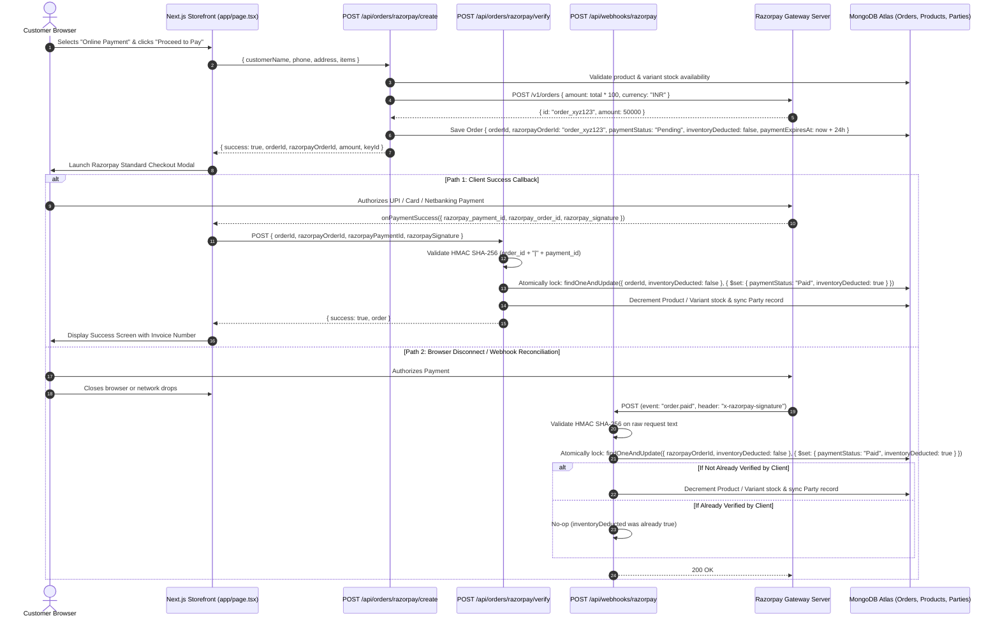

# Customer Razorpay Payment Gateway Integration

*   **Author:** kishoresharmaks
*   **Status:** Proposed
*   **Date:** 2026-11-15

--------------------------------------------------------------------------------

## Overview

This design outlines the migration of the customer storefront payment flow from an unverified manual UPI QR code and UTR submission process to an automated integration with Razorpay Standard Checkout (`checkout.js`). The new flow handles orders across UPI, credit/debit cards, net banking, and wallets, while retaining Cash on Delivery (COD) as an independent choice. It incorporates server-side cryptographic signature validation, an asynchronous webhook reconciliation worker for dropped browser sessions, and atomic database state transitions that guarantee inventory is only deducted upon verified payment capture.

## The Problem

The current checkout mechanism in `app/page.tsx` relies on customer-side manual intervention:
1. **High Friction and Cart Abandonment**: Customers are prompted to switch apps, scan a dynamic QR code or copy a merchant VPA, complete payment in their banking app, locate a 12-digit bank reference (UTR) number, and manually paste it into the storefront before placing an order.
2. **Fraud Risk and Manual Reconciliation**: Orders are recorded in a `Pending` state based solely on whatever text the customer types into the transaction ID field. Store personnel must manually log into their banking portal or UPI app to cross-reference each UTR against bank credits before processing shipments.
3. **Premature Stock Decrementing**: In `app/api/orders/route.ts`, inventory is decremented when the checkout payload is received. Unpaid abandoned orders hold phantom inventory, reducing available stock for paying customers.
4. **Lack of Drop-Off Recovery**: If a customer completes payment at their bank but their network drops or they close the browser tab before the callback completes, the transaction is orphaned with no automated fulfillment mechanism.

The proposed solution replaces the manual UPI interface with the Razorpay Standard Checkout modal. A server-side endpoint generates an official Razorpay Order, the frontend opens the checkout popup, and the server validates the HMAC SHA-256 signature upon return. A secondary webhook listener intercepts `order.paid` events directly from Razorpay to guarantee order fulfillment even if the browser disconnects. Inventory is decremented atomically only after cryptographic proof of payment is confirmed.

## Goals

*   Eliminate manual UTR entry by integrating Razorpay Standard Checkout in the customer checkout modal (`app/page.tsx`).
*   Defer inventory deduction until payment is cryptographically verified on the server, eliminating phantom inventory holds on abandoned checkouts.
*   Support automated recovery for dropped client sessions via authenticated asynchronous Razorpay webhooks (`order.paid` and `payment.captured`).
*   Enforce idempotent database operations to prevent duplicate order generation or double inventory deduction if the client callback and webhook fire simultaneously.
*   Detect and flag simultaneous-checkout stock depletion scenarios (`inventoryConflict: true`) in the admin dashboard without canceling captured payments.
*   Retain Cash on Delivery (COD) with existing store settings toggles (`models/Settings.ts`).

## Non-Goals

*   Automated programmatic refunds on stock-out: The merchant will evaluate inventory conflicts in the dashboard and issue restocks or refunds manually.
*   In-store POS counter hardware or API integration: In-store billing continues using local counter cash and static UPI QR.
*   Recurring subscriptions or auto-debit billing schedules for consumer retail products.
*   Custom white-label payment gateway UI: Razorpay Standard Checkout modal meets all brand and UX requirements without custom card-form PCI compliance overhead.

## Open Questions

*   None: All major architectural questions (inventory deduction timing, webhook recovery, settings schema compatibility, and conflict resolution) were resolved during the ideation phase.

## Critical User Journeys (CUJs)

### CUJ 1: Successful Online Purchase via Razorpay
*   **Given**: A customer has products in their cart and opens the checkout drawer on the storefront.
*   **When**: The customer enters shipping details, selects "Online Payment (Razorpay)", and clicks "Proceed to Pay".
*   **Then**: The storefront requests a Razorpay order from `POST /api/orders/razorpay/create`. An order record is saved with `paymentStatus: 'Pending'`. The Razorpay modal opens. The customer completes payment via UPI/Card. Razorpay invokes the client callback, which sends verification data to `POST /api/orders/razorpay/verify`. The server verifies the HMAC signature, updates `paymentStatus: 'Paid'`, decrements product/variant stock, and displays the order confirmation screen with the generated invoice ID.

### CUJ 2: Recovery of Dropped Browser Session via Webhook
*   **Given**: A customer completes payment in their bank app via the Razorpay modal.
*   **When**: The customer's mobile device loses connectivity or the customer closes the browser tab before the client callback executes.
*   **Then**: Razorpay sends an asynchronous `order.paid` webhook to `POST /api/webhooks/razorpay`. The webhook validates the `X-Razorpay-Signature` against `RAZORPAY_WEBHOOK_SECRET` using raw request text. It locates the pending order, atomically updates `paymentStatus: 'Paid'`, decrements product/variant stock, and sets `inventoryDeducted: true`. When the customer later checks order status via phone number, the order displays as Paid.

### CUJ 3: Simultaneous Checkout on Last Unit (Inventory Conflict)
*   **Given**: Product A has 1 unit remaining in stock. Customer 1 and Customer 2 both open the checkout modal simultaneously.
*   **When**: Both customers authorize payment on Razorpay. Customer 1's payment verifies first and decrements the remaining unit to 0. Customer 2's payment verifies 2 seconds later.
*   **Then**: Customer 2's order is verified and updated to `paymentStatus: 'Paid'`. The atomic inventory check detects 0 remaining stock, sets `inventoryConflict: true`, and records conflict notes. The transaction is not refunded automatically; an alert is posted in the admin dashboard for the store manager to fulfill from backorder or issue a refund via the Razorpay portal.

### CUJ 4: Cash on Delivery Checkout (Regression Protection)
*   **Given**: A customer selects "Cash on Delivery" in the checkout drawer.
*   **When**: The customer clicks "Place Cash on Delivery Order".
*   **Then**: The order is submitted to `POST /api/orders`. The order is created with `paymentMethod: 'COD'`, `paymentStatus: 'Pending'`, and inventory is decremented immediately, matching the existing operational workflow.

--------------------------------------------------------------------------------

## Technical Plan (Architecture)

### Component Architecture & Module Responsibilities

The online payment system consists of four primary components:
1. **Client Checkout Layer (`app/page.tsx`)**: Renders payment options, dynamically binds the Razorpay Checkout SDK, initializes payment modals, and routes payment responses.
2. **Order Creation Service (`POST /api/orders/razorpay/create`)**: Validates real-time cart inventory, contacts Razorpay to generate an official order entity, creates a persistent `Payment_Pending` order in MongoDB, and returns checkout options to the client.
3. **Cryptographic Verification Worker (`POST /api/orders/razorpay/verify`)**: Validates the SHA-256 HMAC signature returned by the client, executes atomic database state transitions, and triggers product and variant stock deductions.
4. **Asynchronous Webhook Listener (`POST /api/webhooks/razorpay`)**: Consumes raw HTTP requests from Razorpay's webhook infrastructure, validates the webhook HMAC signature, and executes idempotent order fulfillment when client-side callbacks are interrupted.

### System Data Flow



### Data Model & Schema Modifications

#### 1. Schema Extensions in `models/Order.ts`
```typescript
// Extended fields in IOrder interface and OrderSchema
{
  paymentMethod: {
    type: String,
    enum: ['COD', 'UPI', 'CASH', 'RAZORPAY'],
    required: true,
  },
  paymentStatus: {
    type: String,
    enum: ['Pending', 'Paid', 'Failed'],
    default: 'Pending',
  },
  razorpayOrderId: { type: String, sparse: true, index: true },
  razorpayPaymentId: { type: String, sparse: true, index: true },
  razorpaySignature: { type: String },
  inventoryDeducted: { type: Boolean, default: false, index: true },
  inventoryConflict: { type: Boolean, default: false },
  conflictNotes: { type: String, default: '' },
  paymentExpiresAt: { type: Date, index: { expires: '24h' } },
}
```

#### 2. Variant-Aware Inventory Decrementing
The existing decrement logic in `app/api/orders/route.ts` only modified top-level product quantities. The shared inventory decrement utility will execute:
```typescript
if (item.variantName) {
  await Product.updateOne(
    { _id: item.productId, 'variants.name': item.variantName },
    { $inc: { 'variants.$.quantity': -itemQty, quantity: -itemQty } }
  );
} else {
  await Product.findByIdAndUpdate(item.productId, {
    $inc: { quantity: -itemQty }
  });
}
```

### Concurrency and Idempotency Invariants

1. **Atomic Guard Condition**: Double-deductions are eliminated by requiring the state mutation to test `inventoryDeducted: false`:
   ```typescript
   const lockedOrder = await Order.findOneAndUpdate(
     { orderId, inventoryDeducted: false },
     {
       $set: {
         paymentStatus: 'Paid',
         status: 'Processing',
         inventoryDeducted: true,
         razorpayPaymentId,
         razorpaySignature,
       },
     },
     { new: false }
   );
   ```
   Only the thread that receives `lockedOrder !== null` proceeds to decrement inventory.
2. **Sequential Order ID Safety**: To prevent duplicate key collisions on `orderId` under simultaneous checkouts, order ID generation is updated to use a timestamp-sequence pattern (`ORD-${Date.now().toString().slice(-6)}-${Math.floor(1000 + Math.random() * 9000)}`) or atomic counter increment, replacing the unsafe `Order.countDocuments()` pattern.
3. **Next.js 14 Raw Body Webhook Verification**: The webhook endpoint reads `await request.text()` before passing it to `crypto.createHmac('sha256', secret).update(body).digest('hex')`. Parsing JSON before signature calculation is strictly avoided.

--------------------------------------------------------------------------------

## Alternatives Considered

### Alternative A: Manual Direct UPI + UTR Entry (Status Quo)

*   **Pros**: Zero transaction fees; no external merchant onboarding requirements.
*   **Cons**: Unacceptable checkout drop-off rates; high fraud risk from forged reference numbers; requires continuous manual reconciliation of bank statements.
*   **Reason for Rejection**: Rejected by author: Causes unacceptable checkout friction and creates accounting risks through unverified customer-supplied reference numbers.

### Alternative B: Pre-Payment Inventory Locking with Timeouts

*   **Pros**: Guarantees stock availability for the shopper while completing payment.
*   **Cons**: Strands inventory on abandoned payment screens; requires a distributed scheduled worker or cron job to release expired holds.
*   **Reason for Rejection**: Rejected by author: Holding inventory before payment completion creates stranded stock on abandoned checkouts. Stock is deducted strictly upon payment verification.

### Alternative C: Storing Order Payloads Exclusively in Razorpay Notes

*   **Pros**: Avoids creating uncommitted `Payment_Pending` records in MongoDB prior to payment.
*   **Cons**: Razorpay limits the `notes` metadata object to 15 key-value pairs and 256 characters per value, which truncates complex multi-item orders, variants, and long delivery addresses.
*   **Reason for Rejection**: Rejected by author: Razorpay notes field limits prevent encoding multi-item carts, variants, and long delivery addresses, risking data loss during webhook recovery.

### Alternative D: Automated Programmatic Refunds on Stock Depletion

*   **Pros**: Zero merchant touchpoint needed when simultaneous checkouts exhaust stock.
*   **Cons**: Bank refunds take 5 to 7 business days to credit back to the customer's account, creating severe customer dissatisfaction when the customer believed their order succeeded; deprives the merchant of fulfilling via incoming replenishment stock.
*   **Reason for Rejection**: Rejected by author: Automatic refunds trigger bank settlement delays and customer dissatisfaction; flagging the order for administrative review gives the merchant the option to fulfill from reserve stock or coordinate directly with the buyer.

--------------------------------------------------------------------------------

## Non-Functional Requirements

### Security & Secrets Management
*   `RAZORPAY_KEY_SECRET` and `RAZORPAY_WEBHOOK_SECRET` must remain strictly server-side environment variables and must never be exposed via `NEXT_PUBLIC_*` prefixes.
*   All webhooks must validate the `x-razorpay-signature` header using HMAC SHA-256 over raw request text before executing any database mutations.
*   All client-side verification requests must validate the cryptographic signature over `razorpay_order_id + "|" + razorpay_payment_id`.

### Performance & Latency
*   Order creation endpoint must execute within < 500ms (1 MongoDB read + 1 Razorpay REST call + 1 MongoDB insert).
*   Webhook listener must respond with `200 OK` in < 300ms to prevent Razorpay delivery retries.
*   Razorpay SDK script (`checkout.js`) must be loaded non-blockingly using Next.js `<Script strategy="lazyOnload">`.

### Rollout & Backward Compatibility
*   The `models/Settings.ts` configuration toggle `enableUPI` will be preserved and repurposed to control Razorpay online payments, ensuring existing admin dashboard toggles function without database migration.
*   Cash on Delivery (COD) remains fully backward-compatible and operational independently of Razorpay gateway availability.

--------------------------------------------------------------------------------

### Additional Resources

*   Razorpay India Developer Documentation: `https://razorpay.com/docs/_llms/india.txt`
*   Razorpay Standard Web Checkout Guide: `https://razorpay.com/docs/payments/payment-gateway/web/standard/`
*   Razorpay Webhooks Documentation: `https://razorpay.com/docs/webhooks/`

### Future Improvements

*   **Admin Dashboard One-Click Refunds**: Add an administrative refund button inside `/admin/dashboard` allowing store staff to trigger instant Razorpay refunds directly from the order details view without logging into the Razorpay dashboard.
*   **Automated Abandoned Cart Recovery**: Use PostHog event streams on `razorpay_order_created` without matching `razorpay_payment_success` to trigger WhatsApp or SMS follow-up messages after 1 hour.

--------------------------------------------------------------------------------

## Detailed Implementation Plan

### Target Files to Create / Modify

#### 1. `models/Order.ts` (Modify)
*   **Type / Scope**: Mongoose Database Schema & TypeScript Interfaces
*   **Rationale**: Extend the `IOrder` interface and `OrderSchema` to store Razorpay order, payment, and signature identifiers, track atomic inventory deduction state, record simultaneous checkout conflict flags, and establish a 24-hour TTL index for abandoned pending checkouts.
*   **Proposed Changes**:
    *   Add `'RAZORPAY'` to `paymentMethod` enum.
    *   Add fields `razorpayOrderId` (string, indexed), `razorpayPaymentId` (string, indexed), `razorpaySignature` (string).
    *   Add `inventoryDeducted` (boolean, default: false, indexed) to enforce atomic state mutation guards.
    *   Add `inventoryConflict` (boolean, default: false) and `conflictNotes` (string).
    *   Add `paymentExpiresAt` (date, with `{ expires: '24h' }` TTL index).

#### 2. `lib/razorpay.ts` (Create)
*   **Type / Scope**: Server-Side Gateway Utilities
*   **Rationale**: Centralize all Razorpay HTTP client calls, credentials access, and cryptographic signature validations to ensure consistent error handling and prevent code duplication between client verification and webhook routes.
*   **Proposed Changes**:
    *   Export `createRazorpayOrder({ amount, currency, receipt, notes })` using `fetch` with Basic Auth against `https://api.razorpay.com/v1/orders`.
    *   Export `verifyRazorpayPaymentSignature({ orderId, paymentId, signature })` using `crypto.createHmac('sha256', process.env.RAZORPAY_KEY_SECRET)`.
    *   Export `verifyRazorpayWebhookSignature({ rawBody, signature })` using `crypto.createHmac('sha256', process.env.RAZORPAY_WEBHOOK_SECRET)`.

#### 3. `lib/inventory.ts` (Create)
*   **Type / Scope**: Shared Inventory & Order Fulfillment Service
*   **Rationale**: Encapsulate atomic stock decrementing, variant stock updates, party directory synchronization, and conflict resolution into a reusable idempotent function consumed by both the verification endpoint and the webhook listener.
*   **Proposed Changes**:
    *   Export `fulfillOrderAtomically({ orderId, razorpayPaymentId, razorpaySignature })`.
    *   Executes `Order.findOneAndUpdate({ orderId, inventoryDeducted: false }, ...)` to acquire execution lock.
    *   Loops through line items to decrement `Product.quantity` or `Product.variants.$.quantity`.
    *   Flags `inventoryConflict: true` if available quantity is less than requested quantity.
    *   Syncs customer contact details into `models/Party.ts`.

#### 4. `app/api/orders/razorpay/create/route.ts` (Create)
*   **Type / Scope**: Next.js 14 Route Handler (`POST`)
*   **Rationale**: Expose an authenticated endpoint for the customer checkout modal to initiate an official Razorpay order, perform pre-flight stock checks, and persist an initial `Payment_Pending` order in MongoDB.
*   **Proposed Changes**:
    *   Validate customer name, phone, email, delivery address, pincode, and item array.
    *   Verify that products and requested variants have `quantity >= requestedQty`.
    *   Generate a unique sequential order ID (`ORD-${Date.now().toString().slice(-6)}-${Math.floor(1000 + Math.random() * 9000)}`).
    *   Call `createRazorpayOrder` for `Math.round(totalAmount * 100)` paise.
    *   Create `Order` document with `paymentStatus: 'Pending'`, `inventoryDeducted: false`, and `paymentExpiresAt: Date.now() + 24*3600*1000`.
    *   Return `{ success: true, orderId, razorpayOrderId, amount, currency: 'INR', keyId }`.

#### 5. `app/api/orders/razorpay/verify/route.ts` (Create)
*   **Type / Scope**: Next.js 14 Route Handler (`POST`)
*   **Rationale**: Provide immediate client-side payment confirmation by verifying the cryptographic signature returned by the Razorpay popup and triggering atomic order fulfillment.
*   **Proposed Changes**:
    *   Accept `{ orderId, razorpayOrderId, razorpayPaymentId, razorpaySignature }`.
    *   Verify HMAC SHA-256 signature; return HTTP 400 on signature mismatch.
    *   Invoke `fulfillOrderAtomically`.
    *   Track `razorpay_payment_verified` event via PostHog.
    *   Return `{ success: true, message: 'Payment verified', data: order }`.

#### 6. `app/api/webhooks/razorpay/route.ts` (Create)
*   **Type / Scope**: Next.js 14 Webhook Handler (`POST`)
*   **Rationale**: Asynchronously capture `order.paid` and `payment.captured` events directly from Razorpay to guarantee order fulfillment when customers disconnect before the client callback runs.
*   **Proposed Changes**:
    *   Read raw request text via `await request.text()`.
    *   Validate `x-razorpay-signature` against `RAZORPAY_WEBHOOK_SECRET`.
    *   Extract `razorpay_order_id` from event payload.
    *   Locate target order by `razorpayOrderId`.
    *   Invoke `fulfillOrderAtomically`.
    *   Acknowledge receipt with `NextResponse.json({ status: 'ok' })` in < 300ms.

#### 7. `app/api/orders/route.ts` (Modify)
*   **Type / Scope**: Next.js 14 Route Handler (`POST`, `GET`)
*   **Rationale**: Maintain Cash on Delivery (COD) processing, fix variant inventory deduction bug, and remove obsolete manual UPI UTR processing.
*   **Proposed Changes**:
    *   Update sequential order ID generation to use collision-resistant sequence logic.
    *   Fix variant stock decrements (`variants.$.quantity`).
    *   Restrict `POST /api/orders` to `'COD'` payment methods.

#### 8. `app/page.tsx` (Modify)
*   **Type / Scope**: Next.js Storefront Client Component
*   **Rationale**: Replace the manual UPI QR code, merchant VPA copy button, and 12-digit UTR input form with Razorpay Standard Checkout popup integration.
*   **Proposed Changes**:
    *   Add Next.js `<Script src="https://checkout.razorpay.com/v1/checkout.js" strategy="lazyOnload" />`.
    *   Replace UPI VPA/QR rendering in the checkout drawer with a modern "Pay Online (UPI, Cards, NetBanking)" selector.
    *   Bind `handlePlaceOrder`:
        *   If `paymentMethod === 'RAZORPAY'`: Call `/api/orders/razorpay/create`, instantiate `new window.Razorpay(options)`, and open popup.
        *   On `handler` success: Post tokens to `/api/orders/razorpay/verify`, clear cart, and trigger order success modal.
        *   On `modal.ondismiss`: Retain form data and cart in place; display subtle ambient retry notice.
        *   If `paymentMethod === 'COD'`: Submit to `/api/orders` as before.

#### 9. `.env.example` & Runtime Configuration (Modify)
*   **Type / Scope**: Environment Configuration
*   **Rationale**: Document the required gateway secrets and public client keys.
*   **Proposed Changes**:
    *   Add `RAZORPAY_KEY_ID=rzp_test_...`
    *   Add `NEXT_PUBLIC_RAZORPAY_KEY_ID=rzp_test_...`
    *   Add `RAZORPAY_KEY_SECRET=...`
    *   Add `RAZORPAY_WEBHOOK_SECRET=...`

---

### Verification Plan

#### 1. Automated Build & Compilation
*   Run `npm run build` to verify type safety across modified Mongoose schemas, Next.js Route Handlers, and client components.
*   Verify zero TypeScript errors across `models/Order.ts` and API routes.

#### 2. Manual & Functional Testing
*   **Test Case 1: End-to-End Online Checkout (Happy Path)**:
    *   Add products to cart on storefront (`/`).
    *   Click "Proceed to Pay" with Razorpay selected.
    *   Use Razorpay test UPI/Card credentials in popup to authorize payment.
    *   Verify instant redirection to Order Confirmation modal displaying valid invoice and order ID.
    *   Query MongoDB to confirm `paymentStatus === 'Paid'`, `inventoryDeducted === true`, and product stock decremented.
*   **Test Case 2: Webhook Recovery (Dropped Session)**:
    *   Initiate Razorpay checkout modal.
    *   Authorize test payment in the modal, but immediately force-close the browser tab before callback returns.
    *   Simulate/await Razorpay webhook delivery to `/api/webhooks/razorpay`.
    *   Verify server logs show `200 OK` and order is updated to `paymentStatus === 'Paid'` with decremented inventory.
*   **Test Case 3: Concurrency & Idempotency**:
    *   Send concurrent requests to `/api/orders/razorpay/verify` and `/api/webhooks/razorpay` with identical order tokens.
    *   Verify only one request modifies inventory, and product quantity is decremented exactly once.
*   **Test Case 4: Simultaneous Checkout Stock Depletion**:
    *   Set product stock to 1 unit in MongoDB.
    *   Open two browser checkouts simultaneously and pay on both.
    *   Verify Order 1 completes normally with stock = 0.
    *   Verify Order 2 completes with `paymentStatus === 'Paid'` and `inventoryConflict === true`.
*   **Test Case 5: Cash on Delivery (Regression Safety)**:
    *   Place an order with Cash on Delivery selected.
    *   Verify order is created immediately with `paymentMethod === 'COD'`, `paymentStatus === 'Pending'`, and inventory decremented.

--------------------------------------------------------------------------------

<!-- Provenance: Indicates initial structural drafting via EGM. -->

*Drafted with EGM*
